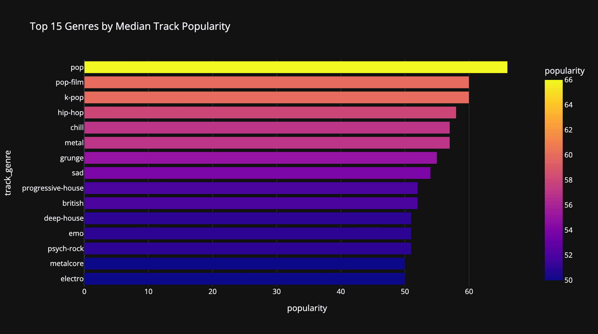
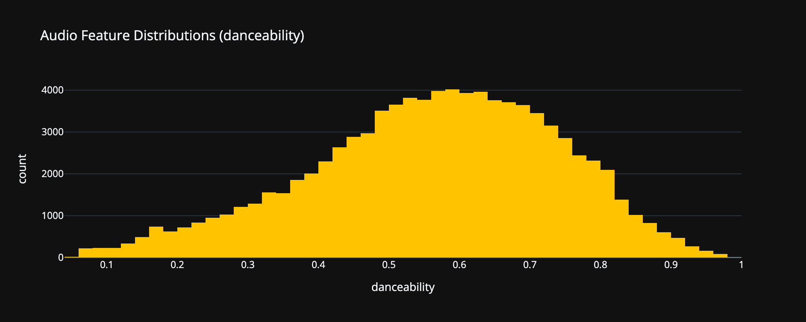
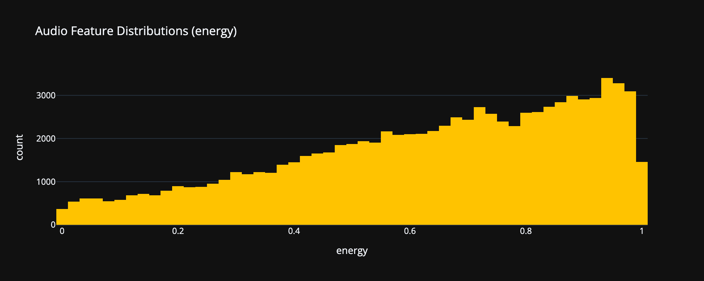
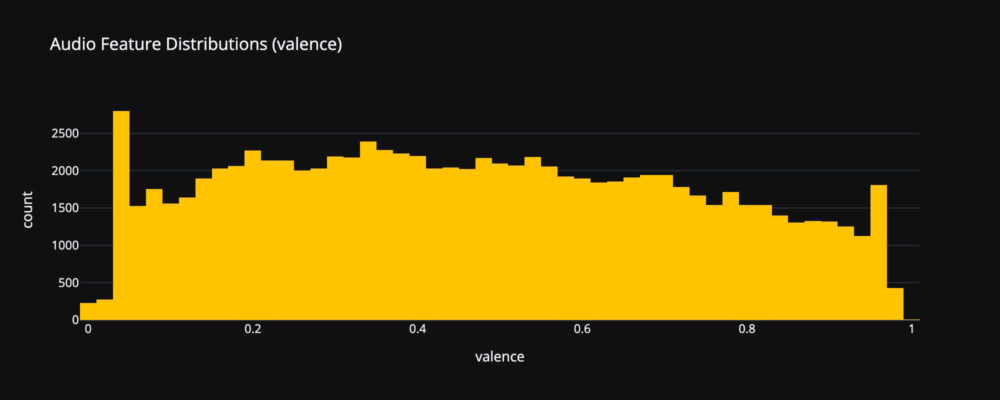
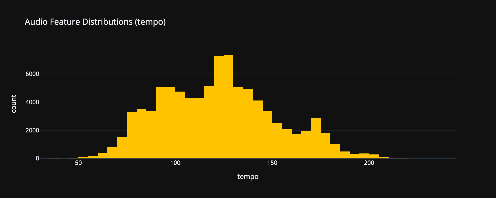
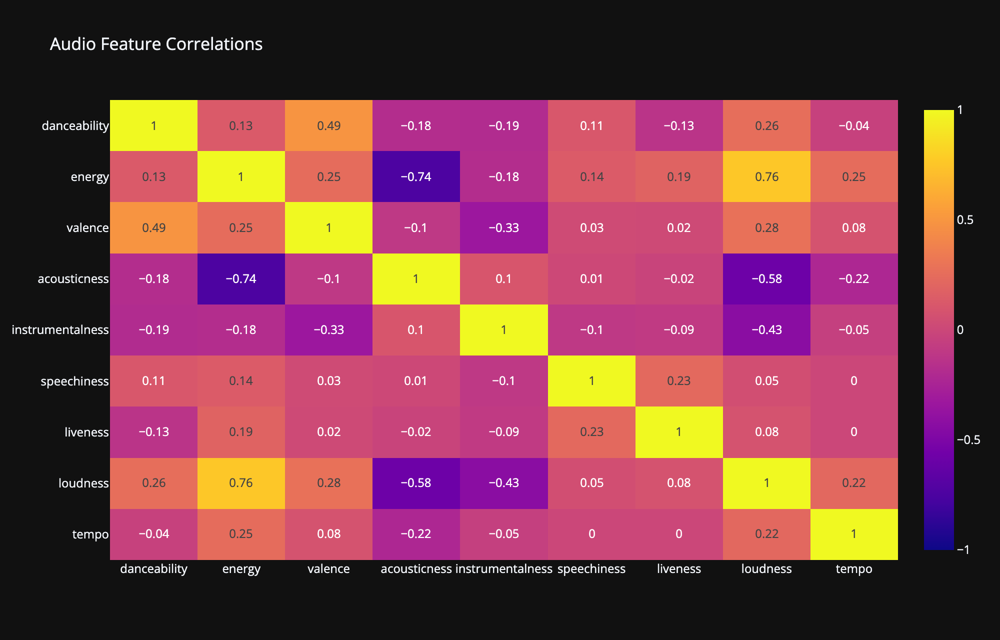
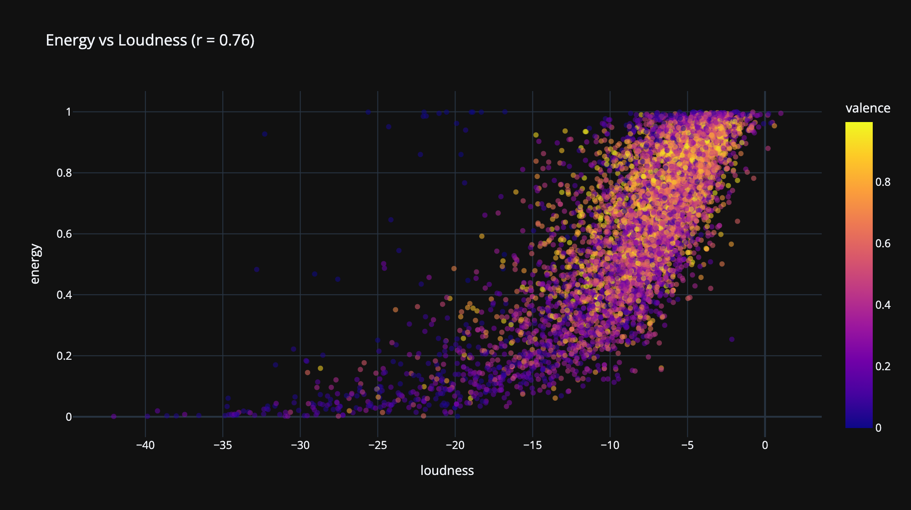
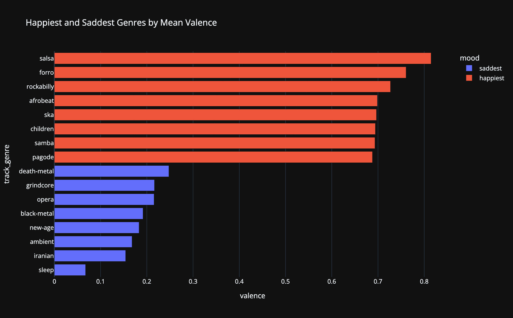
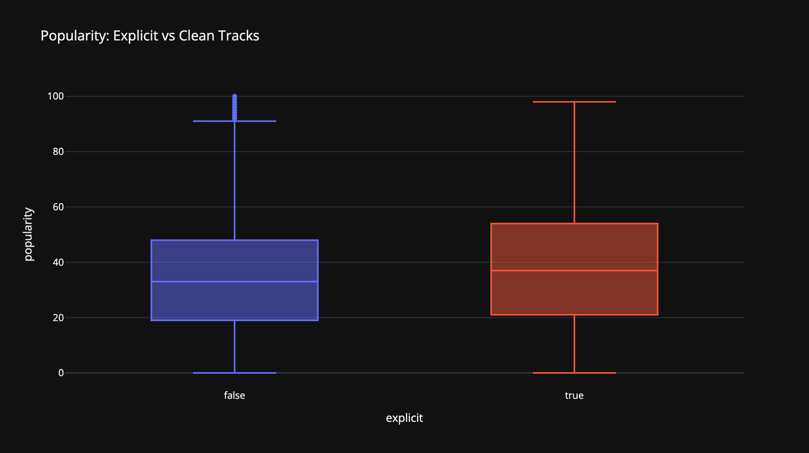

What does Spotify's catalog actually look like as data? This project explores ~114,000 tracks across 114 genres: how the audio features behave, which relationships between them are real, and which genre stereotypes survive contact with the numbers. It ends in an interactive Streamlit app where you can filter the whole dataset yourself with live charts, sliders for danceability, energy, valence, and tempo, and head-to-head genre comparisons.

Try it below, or [open it in a new tab](https://waynes0628-spotify-tracks-explorer-app-5juveb.streamlit.app)

Full notebook and code: [WayneS0628/spotify-tracks-explorer](https://github.com/WayneS0628/spotify-tracks-explorer)

<iframe class="embed" src="https://waynes0628-spotify-tracks-explorer-app-5juveb.streamlit.app/?embed=true" title="Live Streamlit app" loading="lazy"></iframe>

*Live explorer, embedded directly. If it doesn't load, <a href="https://waynes0628-spotify-tracks-explorer-app-5juveb.streamlit.app/">open it in a new tab</a>.*

## The Dataset, and Its One Big Trap

The data comes from the maharshipandya Spotify tracks dataset on HuggingFace, scraped from the Spotify Web API in 2022. Roughly 1,000 tracks per genre, and every audio feature (danceability, energy, valence, acousticness) is the output of Spotify's own audio models, not a raw measurement. That distinction matters later.

The trap: the dataset was built by querying genre by genre, so the same track appears under multiple genres. A crossover hit like Blinding Lights shows up under pop, dance, and synth-pop as three separate rows. That means every analysis has to answer a question first: what should one row represent?

- Dedupe globally and genre stats lose rows, and the rows they lose are exactly the big crossover hits.
- Never dedupe and every distribution or correlation lets hit songs vote multiple times, quietly bending "the average song" toward what hits sound like.

My solution was to keep two versions of the data and route every question to the right one. A genre-grain table (one row per track-genre pair) for anything grouped by genre, and a deduplicated track-grain table (one row per unique song) for distributions and correlations. The litmus test that runs through the whole notebook: if the question mentions genre, use the genre table. If it doesn't, every song gets exactly one vote.

## Which Genres Actually Rank?

Popularity in this dataset is a 0 to 100 score that Spotify weights heavily toward recent streaming. It's also heavily right-skewed, most tracks score low and a few score huge, so I ranked genres by median rather than mean. A mean ranking mostly measures which genres own a few viral outliers. Median asks how the typical track in a genre performs, which is the honest version of the question.

*Top 15 genres by median popularity, TODO: Wayne: one line on which genre won your run*

## What the Features Look Like

Distributions of the four headline features, computed on the deduplicated track table so crossover hits count once. Each feature gets its own histogram because they live on completely different scales (tempo runs to 240 BPM while the rest live between 0 and 1), and binning them together silently breaks the charts. I know because my first version did exactly that.

*Danceability, energy, valence, and tempo across ~89k unique tracks*

The shapes tell a story on their own: energy piles toward the high end (commercial music is loud), valence skews low (more sad songs than happy ones), and tempo humps around the BPM ranges most music actually gets written in.

## How the Features Relate

A correlation heatmap across all nine audio features, again on the track grain. Two relationships dominate: energy and loudness move together strongly, and energy and acousticness pull hard in opposite directions.

*Pearson correlations across the nine audio features*

One caveat I think is worth being upfront about: Spotify partly constructs the energy feature from loudness and dynamics, so a strong correlation there is partly baked in by design, not a discovery about music. When your features are another model's outputs, some relationships come from the model, not the world.

*The headline relationship up close, colored by valence*

## The Genre Mood Map

Mean valence (Spotify's happiness score) per genre, taking the eight highest and eight lowest. The stereotypes hold up almost embarrassingly well: party and Latin genres at the top, ambient and sleep-adjacent genres at the bottom. That face validity is actually a useful result, it suggests valence is measuring something real about the audio rather than noise.

*The happiest and saddest genres by mean valence*

## Does Explicit Content Pay?

Explicit tracks show a higher median popularity than clean ones. Before reading anything into that, the important caveat: this is selection, not causation. Explicit tags cluster inside commercially dominant genres like hip-hop and pop, so the comparison is partly just measuring genre economics. This data cannot tell you that making a track explicit helps it, and I'd rather report the boring true version than the exciting false one.

*Popularity distributions, explicit vs clean*

## Limitations

Every project gets one of these sections, and this dataset earned a long one:

- **No release dates.** The dataset carries no year column, so temporal analysis is impossible. The app uses a popularity filter where I originally planned a year slider.
- **Popularity is a snapshot.** It reflects streaming around the 2022 scrape, not all-time success. Older classics score low.
- **Undocumented sampling.** ~1,000 tracks per genre with no documented selection method, so genre comparisons describe this sample, not all of Spotify.
- **The features are model outputs.** Every chart here is analysis of Spotify's models' opinions about audio, inherited biases included.
- **Not reproducible.** Spotify shut down the audio features endpoint for new apps in late 2024, so this dataset is a frozen snapshot that can never be refreshed.

## What I Took Away

The real work of this project wasn't any chart, it was the grain decision at the top. Deciding what one row represents, and refusing to pick a single answer when the data needed two, shaped everything downstream. Beyond that: median vs mean as a modeling decision rather than a style preference, catching a silently broken chart by looking at it instead of trusting that running code means correct code, and my first project in Plotly after living in matplotlib and seaborn, which turned out to be a much smaller jump than expected.

Try the [live explorer](https://waynes0628-spotify-tracks-explorer-app-5juveb.streamlit.app) · Full code: [WayneS0628/spotify-tracks-explorer](https://github.com/WayneS0628/spotify-tracks-explorer)
