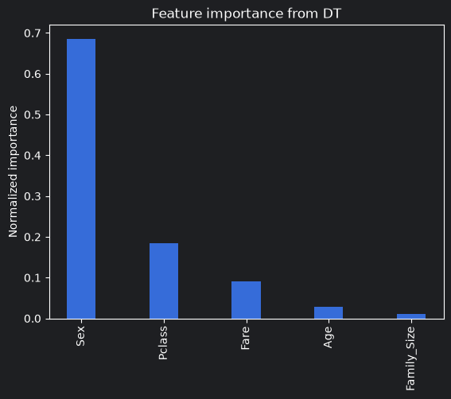
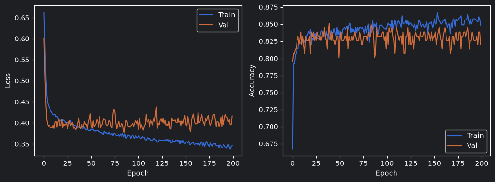

Is a decision tree or a neural network better at predicting Titanic survival, and is the neural network's added complexity actually worth it? This project takes both models through the full ML life cycle side by side: problem definition, data prep, training, hyperparameter tuning, and head-to-head comparison, then puts the winner in front of a real, unseen holdout by submitting it to Kaggle's official leaderboard.

This project builds directly on my earlier [Titanic EDA](https://github.com/WayneS0628/titanic-eda), which found that passenger class and sex dominated survival, that finding is what drove the feature selection here.

Full notebook and code: [WayneS0628/Titanic-DTvsNN](https://github.com/WayneS0628/Titanic-DTvsNN)

## Sharpening the Data Prep

My original EDA filled missing ages with a single global median, and I flagged at the time that a group-wise median by class and sex would be smarter, since first class passengers skewed notably older than third class. I fixed that here: ages are now filled with the median *within each class/sex group*, preserving the real age skew instead of flattening everyone toward the center.

The rest of the prep followed the same disciplined, per-column approach as the EDA project: embarkation port filled with the mode and one-hot encoded, missing cabin data handled honestly rather than imputed, and `sibsp`/`parch` combined into a single `family_size` feature.

Final feature set, chosen from the resulting correlation matrix against survival: **Sex, Fare, Family Size, Age, and Passenger Class.**

## Round One: The Decision Tree

A baseline tree, cross-validated, then tuned with `GridSearchCV` over depth and leaf size. The untuned tree was overfitting a small, 891-row dataset; constraining it to a shallower structure (max depth of 4) actually improved generalization.

*Feature importances from the tuned tree, sex and class dominate, echoing the EDA findings almost exactly*

**Final test performance: 0.811 accuracy, 0.712 F1.**

## Round Two: The Neural Network

A feedforward network built in Keras: three hidden layers (64 → 32 → 16 units, ReLU activations) funneling into a sigmoid output, trained with SGD for 200 epochs. Training took under 8 seconds.

*Training curves showing a modest train/validation gap, mild overfitting, nothing severe*

**Final test performance: 0.867 accuracy, 0.818 F1.**

## The Verdict

The neural network won on both metrics:

| Metric | Decision Tree | Neural Network |
|---|---|---|
| Accuracy | 0.811 | 0.867 |
| F1 Score | 0.712 | 0.818 |

The F1 gap is the one that actually matters: it means the NN wasn't just riding class imbalance to a good-looking accuracy number, it was genuinely better at correctly identifying survivors.

Was the added complexity worth it? At this data scale, yes without question, training took seconds either way, and a 10-point F1 improvement on a life-or-death classification problem is not a rounding error. The tree still earns its keep as the more interpretable option: its feature importances hand a non-technical stakeholder a clean story in one glance, something the neural network can't offer.

## Putting It on a Real Leaderboard

Local test metrics only tell you so much, so I submitted the neural network's predictions to Kaggle's official Titanic leaderboard, scored against a true holdout set I never touched during training.

**Public leaderboard score: 0.7608.**

Worth knowing: the very top of this leaderboard is inflated by entries built from the real historical passenger manifest rather than actual predictions, so a legitimate score generally lands in the 0.75–0.85 range. 0.7608 is a solid, honest result for a single 5-feature network with no ensembling.

It's also meaningfully lower than the 0.867 the same model hit on my local test split, a useful and honest reminder that a 90-row local holdout carries real uncertainty, and shouldn't be trusted as the final word on how a model generalizes.

## Try the Winner

The last step took the winning network out of the notebook entirely. [Would You Have Survived the Titanic?](https://couldyousurvivethetitanic.streamlit.app/) is a small Streamlit app: answer a few questions about yourself and get a live prediction from this exact model. Nothing gets trained in the app, it's pure inference.

App code: [WayneS0628/CouldYouSurviveTheTitanic](https://github.com/WayneS0628/CouldYouSurviveTheTitanic)

Three projects, one thread: explore the data ([Titanic EDA](https://github.com/WayneS0628/titanic-eda)), build and compare models on it, then hand the winner to anyone who wants to play with it.

## What I Took Away

Beyond picking a winner, this project was about being honest with the numbers at every stage: fixing a known flaw from my earlier EDA rather than quietly reusing it, reading training curves for overfitting instead of just chasing a final accuracy number, and treating a big gap between local and leaderboard performance as a finding worth reporting, not a result to bury.

Explore the full notebook, tuning process, and reflections on GitHub: [WayneS0628/Titanic-DTvsNN](https://github.com/WayneS0628/Titanic-DTvsNN)
